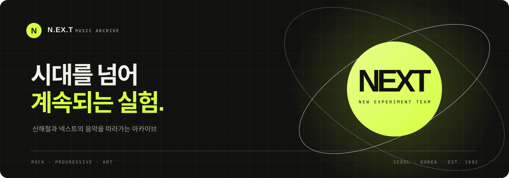

<div align="center">
  

  <br>

  <p><strong>신해철과 넥스트의 음악을 따라가는 작은 아카이브</strong></p>
  <p>
    <a href="https://github.com/b01092661738-prog/next-music-site"><strong>저장소 보기 ↗</strong></a>
    &nbsp;·&nbsp; HTML · CSS · JavaScript
  </p>

  
  
  
</div>

---

## 프로젝트 소개

N.EX.T의 앨범과 곡을 찾아볼 수 있는 반응형 음악 아카이브입니다. 첫 화면에는 2집의 대곡 **〈껍질의 파괴〉**를 소개하고, 앨범별 트랙 목록과 검색 기능을 제공합니다.

> 시대를 넘어 계속되는 실험.

## 주요 기능

- **〈껍질의 파괴〉 스포트라이트** — 곡의 구성과 주제를 소개합니다.
- **앨범별 트랙 탐색** — 정규 앨범과 주요 싱글의 82개 트랙을 모았습니다.
- **검색과 필터** — 곡명이나 앨범명으로 찾고, 앨범별로 좁혀볼 수 있습니다.
- **백그라운드 재생목록** — N.EX.T 관련 YouTube 재생목록을 페이지 하단에 고정해 스크롤 중에도 재생할 수 있습니다.
- **반응형 레이아웃** — 데스크톱과 모바일 화면에 맞춰 배치됩니다.

## 재생 안내

음원 파일을 복제하거나 직접 호스팅하지 않습니다. 공개 YouTube 재생목록을 공식 임베드 플레이어로 표시합니다. 브라우저의 자동재생 정책에 따라 방문자가 직접 재생을 시작해야 하며, 재생 가능 여부는 YouTube 영상의 임베드 설정과 지역별 제공 여부에 따릅니다.

현재 연결된 재생목록은 [Music of Crom이 관리하는 N.EX.T 관련 104개 영상의 커뮤니티 재생목록](https://www.youtube.com/playlist?list=PL5E7998F0FE87B435)입니다. 정규 앨범의 모든 수록곡을 담은 공식 전곡 목록은 아니며, 라이브·중복 영상이 포함될 수 있습니다. 곡 버튼은 플레이어를 열지만, 개별 곡을 자동으로 찾아 재생하지는 않습니다. YouTube 재생목록 안에서 원하는 영상을 선택해 주세요.

현재 목록은 주요 정규 앨범과 싱글을 중심으로 구성되어 있습니다. 라이브 음반, 편집 음반, 게임 OST 등 별도 발매물은 포함하지 않았습니다. 따라서 모든 발매 버전이나 모든 음원의 재생을 보장하지는 않습니다.

## 앨범 목록

| 발매 연도 | 앨범 |
|:--:|---|
| 1992 | *Home* |
| 1994 | *The Return of N.EX.T Part 1: The Being* |
| 1995 | *The Return of N.EX.T Part 2: World* |
| 1997 | *Lazenca - A Space Rock Opera* |
| 2004 | *The Return of N.EX.T Part 3: 개한민국* |
| 2006 | *ReGame? - The 2nd Fan Service* |
| 2008 | *666 Trilogy Part I* |
| 1997–2014 | 주요 싱글 및 기타 트랙 |

## 실행 방법

별도의 패키지 설치나 빌드 과정은 없습니다.

1. 저장소를 내려받거나 복제합니다.
2. `index.html`을 브라우저에서 엽니다.
3. **백그라운드 음악 시작**을 누르고, 페이지 아래 YouTube 플레이어에서 재생합니다.

```bash
git clone https://github.com/b01092661738-prog/next-music-site.git
cd next-music-site
```

정적 사이트 호스팅에 배포할 경우 저장소 루트의 `index.html`을 시작 페이지로 사용하면 됩니다.

## 프로젝트 구조

```text
next-music-site/
├── assets/
│   └── readme-cover.svg
├── index.html       # 페이지 구조와 곡 소개
├── script.js        # 트랙 목록, 검색, 필터, 임베드 플레이어
├── style.css        # 반응형 디자인과 시각 스타일
└── README.md
```

## 크레딧

이 프로젝트는 신해철과 N.EX.T의 음악을 소개하기 위한 팬 아카이브입니다. N.EX.T, 신해철 및 관련 음원·상표의 권리는 각 권리자에게 있습니다. 이 저장소는 음원 파일을 배포하지 않습니다.

---

<div align="center"><sub>신해철과 넥스트의 음악을 기억하며. · N.EX.T MUSIC ARCHIVE</sub></div>
